# 英语语法图谱框架

总图保留十模块；卡片的分类按钮和地图节点都可逐层进入详解。当前有31张主题卡片、135个课程知识点、279个双语例句、405道练习及166颗学习星星。原有记录继续按稳定ID对应。

## 总语法图谱

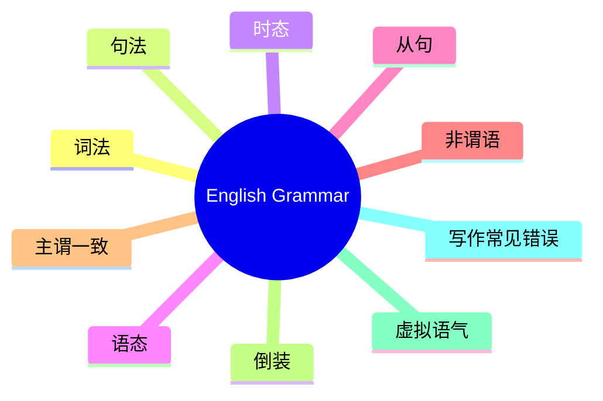

## 词法

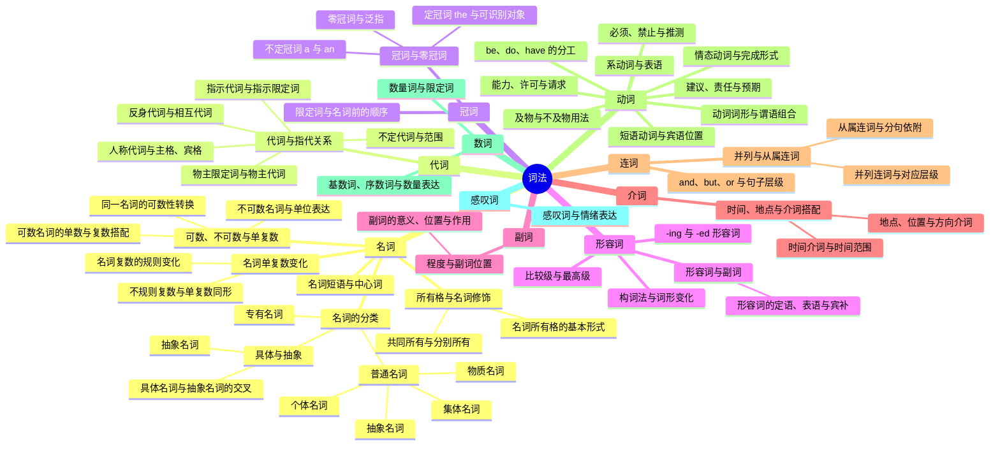

## 句法

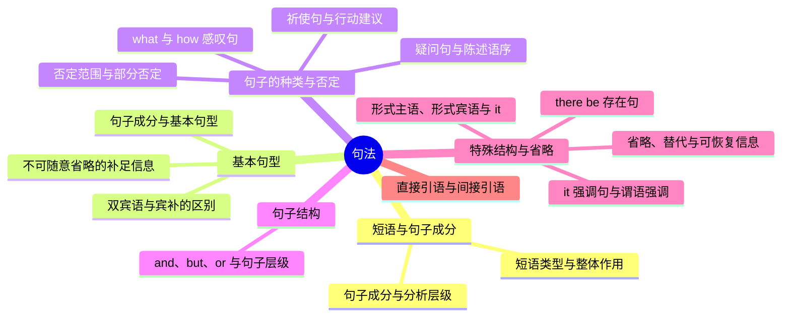

## 时态

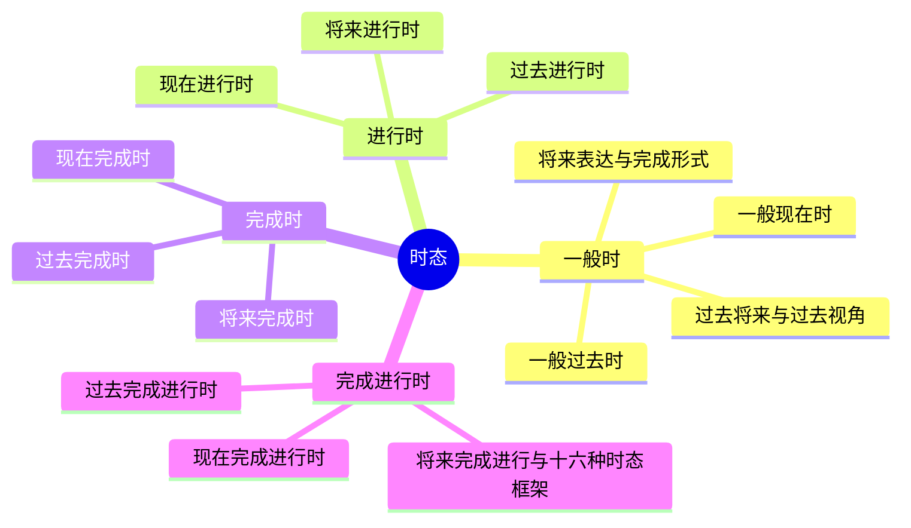

## 语态

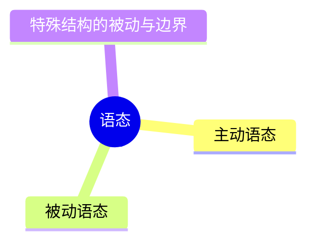

## 从句

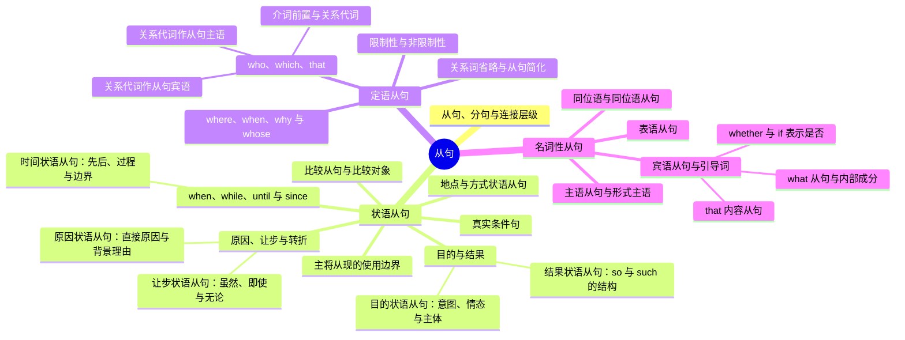

## 非谓语

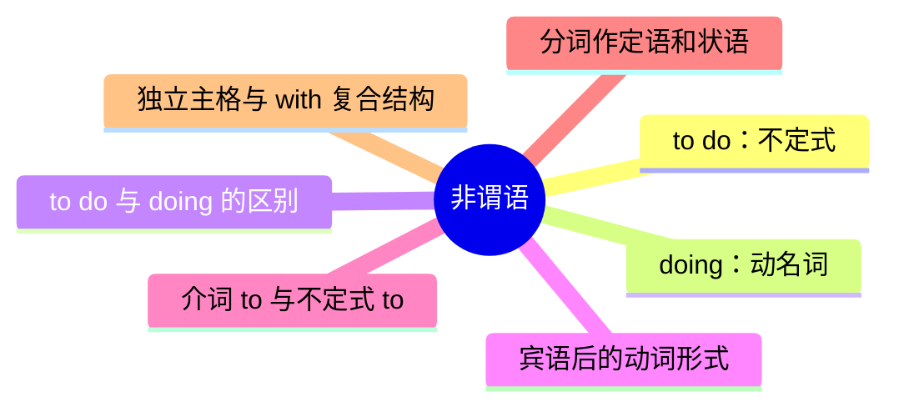

## 主谓一致

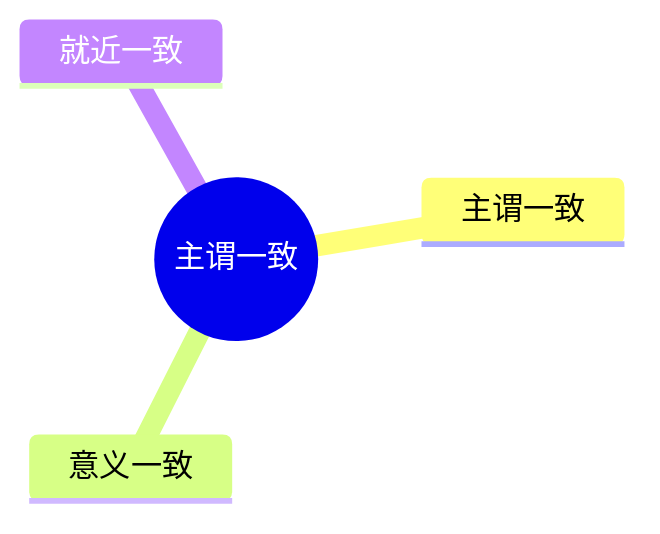

## 倒装

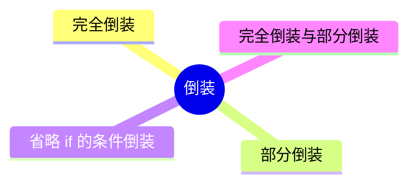

## 虚拟语气

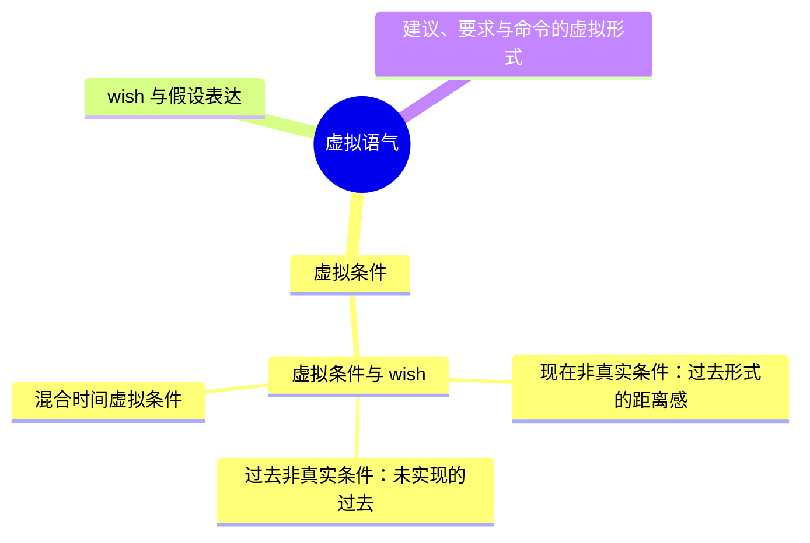

## 写作常见错误

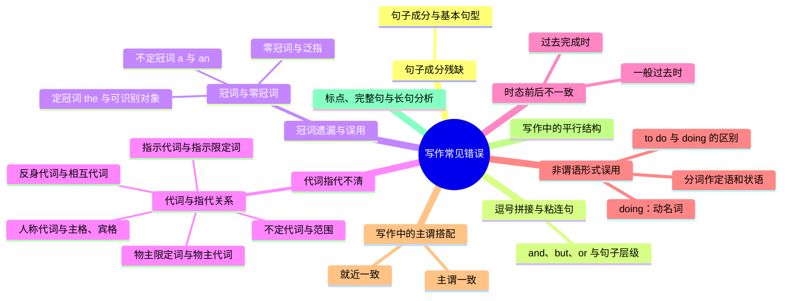

## 分类维度与共享记录

名词的命名类别、具体/抽象意义和可数性分别说明，不能混成一个互斥分类。普通名词下的个体、集体、物质、抽象各有卡片、例句和练习；同一抽象名词节点在不同分支中出现时共用学习记录。

左侧边栏可切换总图、练习、星图和游戏。图谱与讲解之间的分隔手柄可调整阅读空间，50关游戏与旧学习记录保持可用。文档章节对应见 [内容参考与覆盖范围](CURRICULUM_SOURCES.md)。
