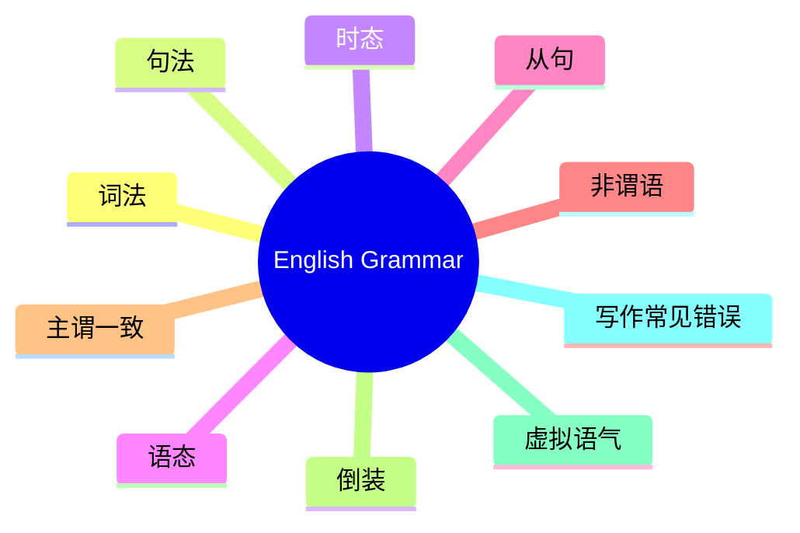
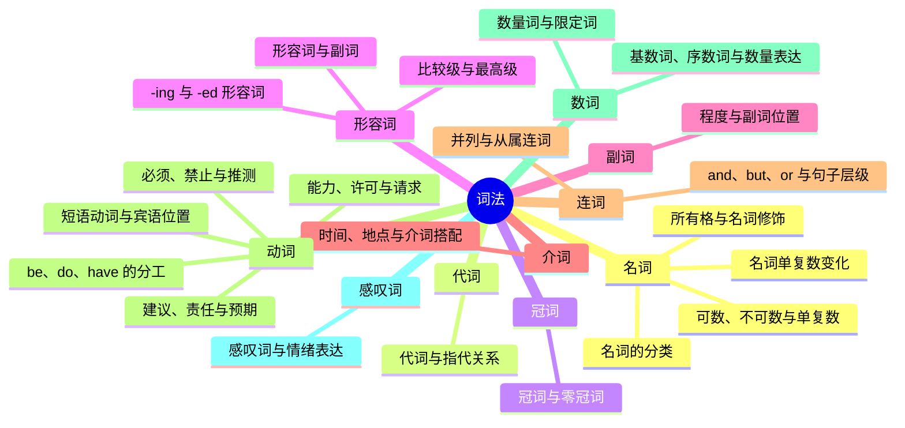
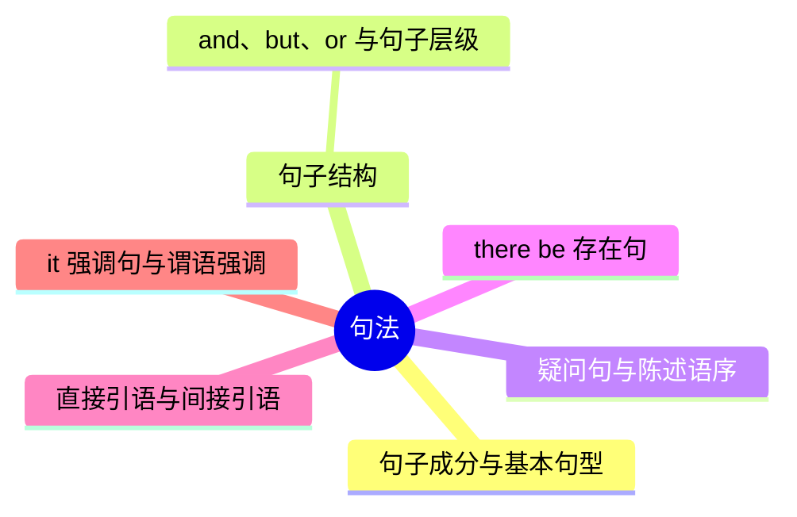
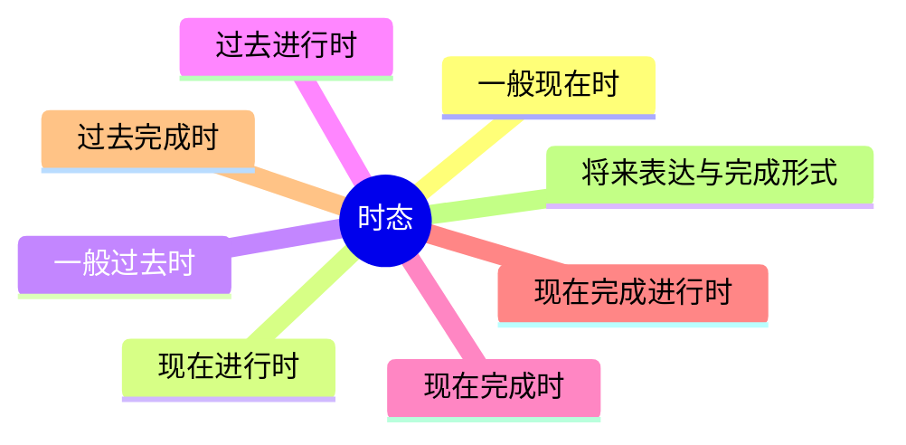
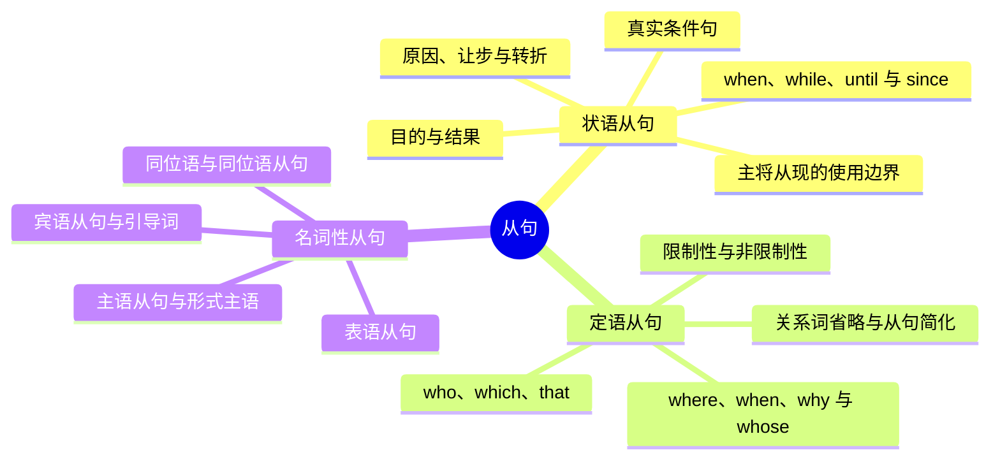
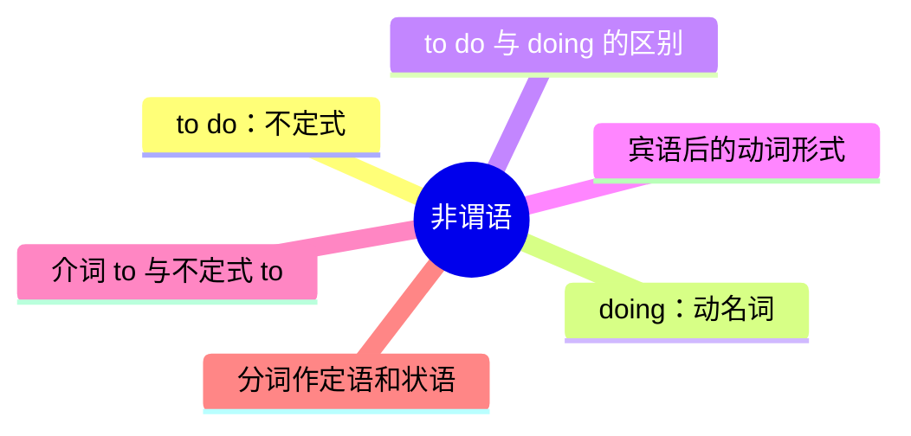
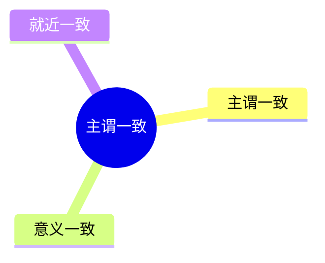
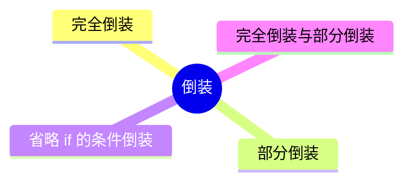
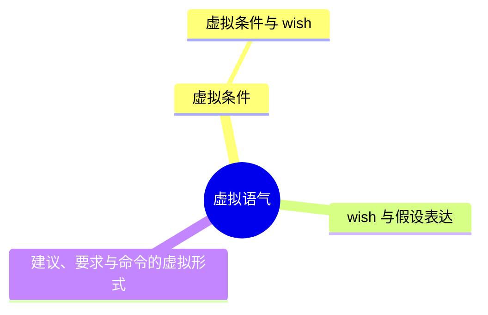
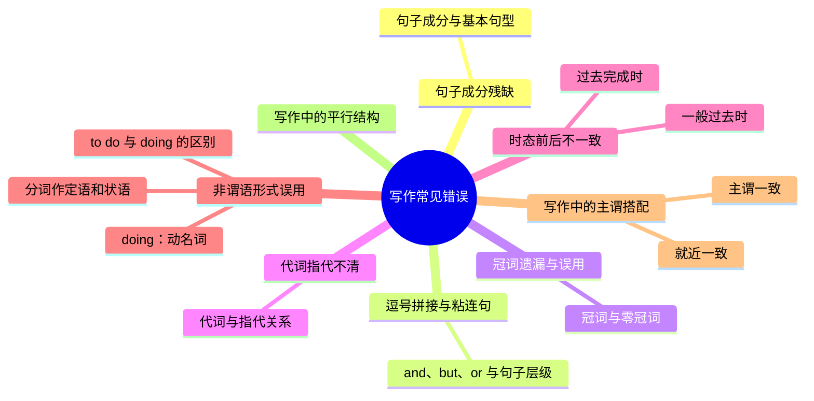

# 英语语法图谱框架

首页总图包含十个模块。点击模块进入子地图，点击知识点打开定义、分类、例句、用法、易错点卡片，再逐层进入练习。下方图表与当前 `atlas.js` 层级一致。

## 总语法图谱

## 词法

## 句法

## 时态

## 语态

## 从句

## 非谓语

## 主谓一致

## 倒装

## 虚拟语气

## 写作常见错误

## 知识卡片与学习星图

名词卡片包含定义、分类、可数与不可数、单复数变化、所有格、常见考点、双语例句和小练习。其他知识点也按定义、分类、例句、用法、易错点组织。

全站共有 22 张主题卡片与 66 个具体知识点，对应 88 颗学习星星。交叉引用共用学习记录；总图和子图不重复计数。右下角圆钮可切换总地图、练习中心、学习星图和游戏。

词性积木游戏包含 50 关，词性选项从名词、动词逐步增加到十大词类；关卡内容和词性标注维护在 `games-content.js`。
