# 英语语法知识点思维导图

按以下顺序拆分为十一张独立导图：

1. 词性
2. 句式
3. 时态与语态
4. 主谓一致
5. 状语从句
6. 定语从句
7. 名词性从句
8. 非谓语动词
9. 虚拟语气
10. 倒装
11. 强调

> 本文是十一类语法的知识框架；网页的具体讲解、例句和练习维护在 `content.js` 中。图表使用 Mermaid mindmap，可在支持 Mermaid 的 Markdown 阅读器中查看。

## 一、词性

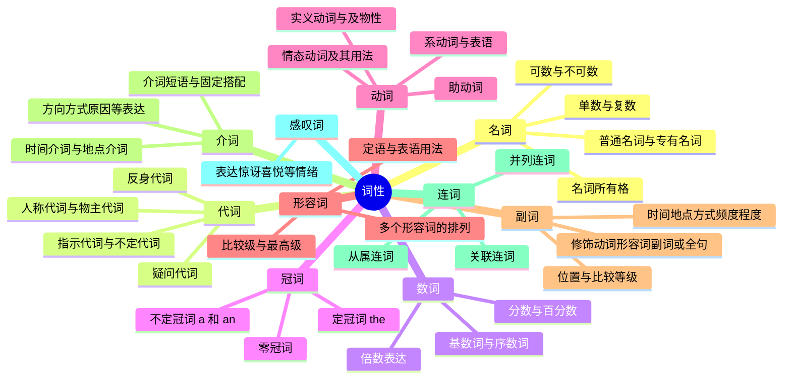

学习重点：区分词性和句子成分。例如，形容词是一种词性，可以在句中作定语或表语；名词可以作主语、宾语或表语。

非谓语动词的形式和用法单独放在第八张导图中。

## 二、句式

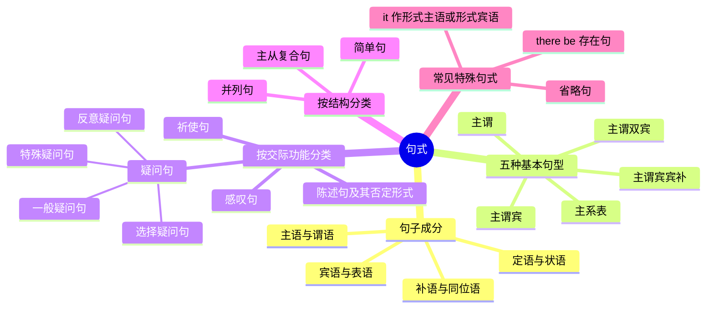

五种基本句型示例：

| 句型 | 例句 |
| --- | --- |
| 主谓 | Birds fly. |
| 主谓宾 | She reads books. |
| 主系表 | He is happy. |
| 主谓双宾 | She gave me a book. |
| 主谓宾宾补 | We call him Tom. |

三类从句、虚拟语气、倒装和强调的具体知识点分别放在各自的独立导图中。

## 三、时态与语态

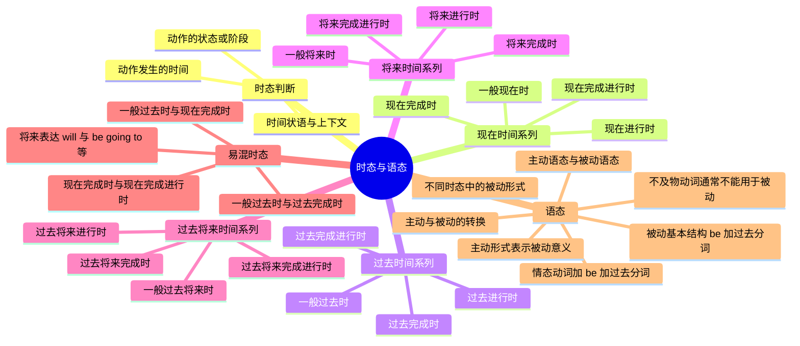

这里采用学校语法中常见的十六种时态归纳法。优先掌握一般现在、一般过去、一般将来、现在进行、过去进行、现在完成、过去完成和一般过去将来；其余逐步扩展。

例句：She writes letters. → Letters are written by her. 时态仍是一般现在时，语态由主动变为被动。

## 四、主谓一致

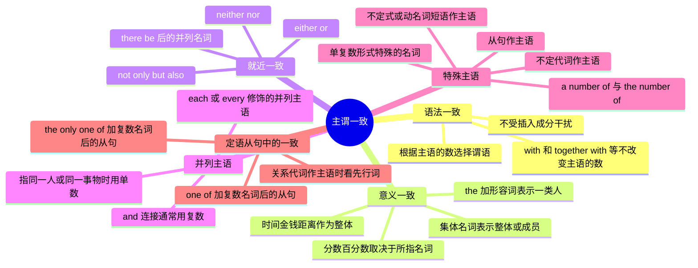

例句：The teacher, together with her students, **is** here. 主语是单数的 the teacher。

易混对比：A number of students **are** absent. / The number of students **is** increasing.

## 五、状语从句

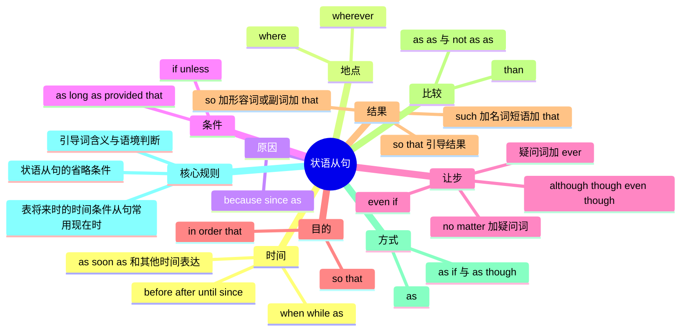

例句：If it **rains** tomorrow, we **will stay** at home. 条件从句用一般现在时表示将来。

注意：because 与 so、although 与 but 在同一层级表达同一逻辑关系时通常不搭配使用。

## 六、定语从句

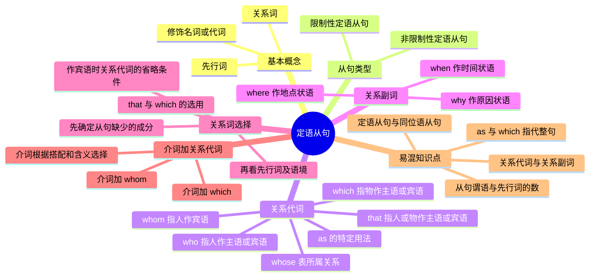

对比：This is the school **which I visited**. / This is the school **where I studied**.

前句缺少 visited 的宾语，选关系代词 which；后句需要地点状语，选关系副词 where。

注意：that 不能引导非限制性定语从句，也不能直接跟在前置介词后。

## 七、名词性从句

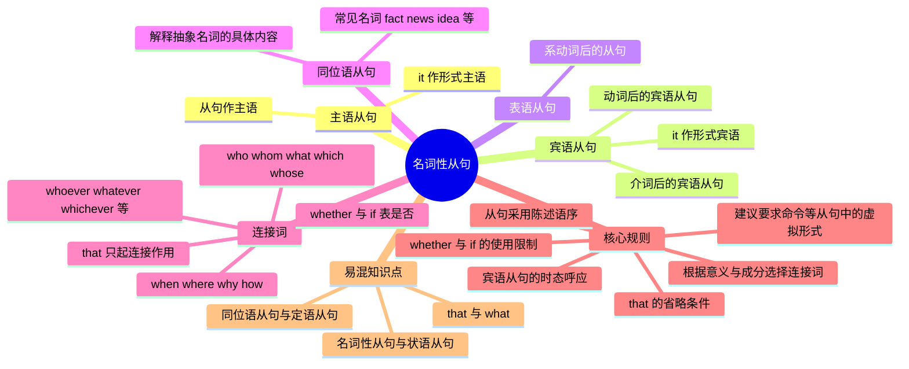

例句：**What he said** is true. / I believe **that he is right**.

what 在第一句从句中作 said 的宾语；that 在第二句从句中不作句子成分。

whether 与 if：前置主语从句、表语从句、同位语从句、紧接介词之后以及不定式之前表达“是否”，通常用 whether。

## 八、非谓语动词

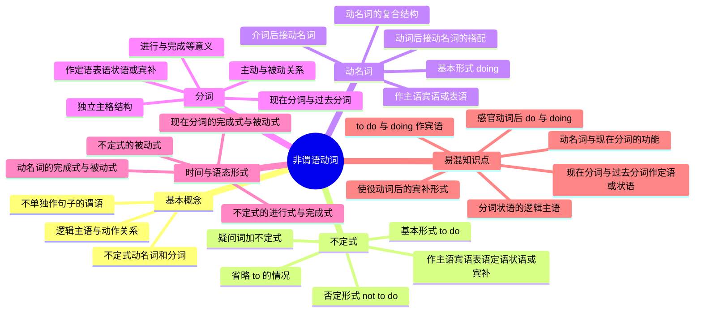

例句：**Reading** helps me relax. / I want **to read** this book. / The girl **reading by the window** is my sister.

判断顺序：先确定所需句子成分，再分析逻辑主语、主动或被动关系，以及动作发生的先后。

## 九、虚拟语气

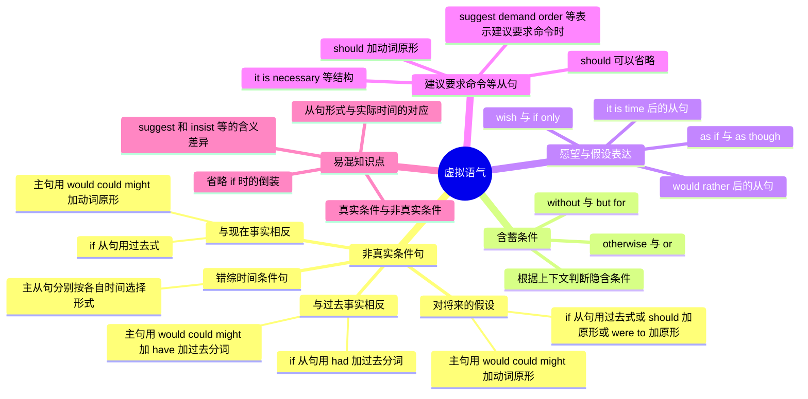

例句：If I **were** you, I **would ask** the teacher. / If I **had known**, I **would have helped** you.

注意：suggest 表示“暗示、表明”、insist 表示“坚持认为”时，其后的从句通常按实际情况使用陈述语气。省略 if 的倒装形式见第十张导图。

## 十、倒装

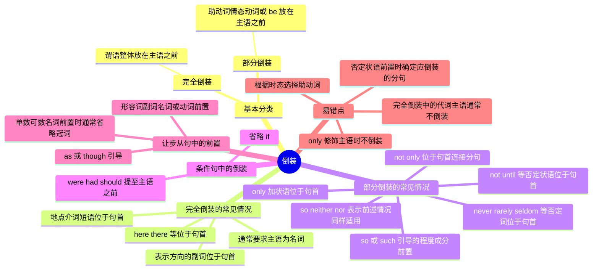

例句：Here **comes the bus**. / Never **have I seen** such a beautiful place. / Only then **did I understand**.

对比：Here **he comes**. 主语为人称代词时通常保持正常语序。Only **Tom** knows the answer. 中 only 修饰主语，也不倒装。

## 十一、强调

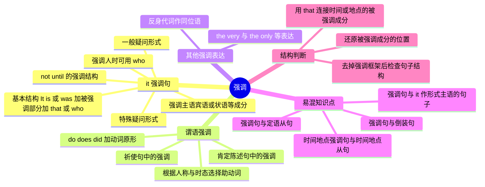

例句：**It was yesterday that** I met her. / I **do agree** with you. / **Do be** careful!

对比：It was **at the school that** I met her. 是强调句；It was **the school where I studied**. 中 where 引导定语从句。

## 跨板块知识点的归属

| 知识点 | 主要归属 | 关联板块 |
| --- | --- | --- |
| 非谓语动词的形式与用法 | 非谓语动词 | 词性中的动词、句式中的句子成分 |
| 非真实条件及愿望等表达 | 虚拟语气 | 状语从句、名词性从句 |
| 特殊语序与前置规则 | 倒装 | 句式、虚拟语气中的条件句 |
| it 强调句与谓语强调 | 强调 | 句式、定语从句的辨析 |
| 从句中的时态 | 时态与语态 | 状语从句、名词性从句中的具体规则 |
| 关系词 | 定语从句 | 词性中的代词与副词 |
| 从句谓语的单复数 | 主谓一致 | 定语从句、名词性从句 |

后续增加知识点时，按以上板块归类，并在网页内容中保留对应讲解、例句和练习。
